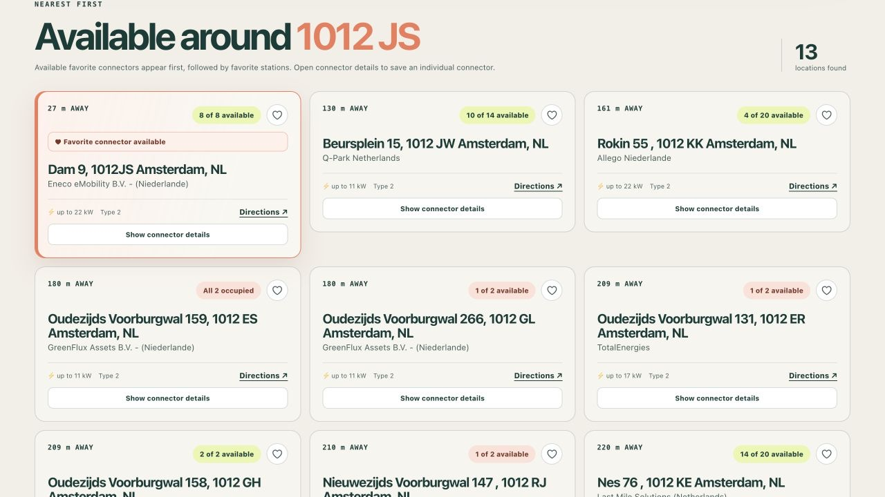
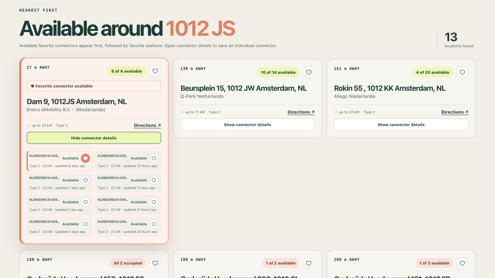

# Charge Nearby

[](https://github.com/roelsroels/charge-nearby/actions/workflows/validate.yml)
[](https://github.com/roelsroels/charge-nearby/releases/latest)
[](LICENSE)
[](package.json)
[](https://charge.roels.com)
[](compose.yaml)
[](package.json)
[](https://github.com/roelsroels/charge-nearby/actions/workflows/coverage.yml)
[](https://github.com/roelsroels/charge-nearby/actions/workflows/codeql.yml)
[](https://github.com/roelsroels/charge-nearby/actions/workflows/deployment-security.yml)
[](https://github.com/roelsroels/charge-nearby/actions/workflows/container-security.yml)
[](https://scorecard.dev/viewer/?uri=github.com/roelsroels/charge-nearby)
[](.github/SECURITY.md)

A small website for finding currently available public EV charging stations around a postcode in the European Netherlands.

Current release: **v1.3.1**

See [CHANGELOG.md](CHANGELOG.md) for release history and unreleased changes.

The browser uses PDOK to locate the postcode. A dependency-free Node service fetches charger locations and availability from the EnBW mobility+ map backend, resolves grouped map results, briefly caches searches, and serves the frontend. The EnBW key never reaches the browser or repository.

CI enforces minimum application-code coverage of 85% lines, 60% branches, and 85% functions. GitHub CodeQL runs its extended JavaScript security queries on every change to `main`, on pull requests, and weekly.

The live deployment's security headers and the runtime container's fixable high/critical vulnerabilities are checked automatically. OpenSSF Scorecard monitors supply-chain practices, and Dependabot proposes weekly Docker and GitHub Actions updates. Please report vulnerabilities through the [security policy](.github/SECURITY.md).

The last successful postcode and favorites are stored unencrypted in that browser's local storage so they survive a return visit. They can be removed using the browser's site-data controls.

The complete interface is available in English and Dutch. Use the `EN` / `NL`
selector in the top-right corner; the selected language is remembered in that
browser's local storage.

## Screenshots





The `Longest connected` button ranks occupied connectors in the selected search
circle by their approximate plug-in duration. Selecting a ranked connector opens
its station on the map. Individual connector panels are loaded only after selecting
`Show connector details`. For occupied connectors, `connected ~…` is calculated
from EnBW's status timestamp and represents approximate plug-in time, regardless
of whether power is flowing. The heart beside an individual EVSE saves that
connector; an available connector favorite receives the coral station and map
highlight shown above.

> [!IMPORTANT]
> This is an unofficial project. It is not affiliated with or supported by EnBW. The EnBW web-map endpoint and browser key can change without notice.

## Quick start with Docker

Requirements: Docker with Compose.

```sh
cp .env.example .env
```

Put the current EnBW browser key in `.env`, then start the service:

```sh
docker compose up -d --build
```

Open `http://localhost:8089` on the Docker host. The published port is deliberately
bound to `127.0.0.1`, so it is not reachable directly over the LAN or internet.
Use a reverse proxy for access from other devices.

The `.env` file is ignored by Git. Do not commit the real key.

By default, at most two distinct uncached EnBW searches run at once. Additional
searches receive a short-lived busy response instead of forming an unbounded queue.
`MAX_CONCURRENT_SEARCHES` can adjust this limit when needed.

## Run directly with Node.js

Requirements: Node.js 22 or newer.

```sh
ENBW_API_KEY="your-current-key" HOST=0.0.0.0 PORT=8080 npm start
```

Use `HOST=127.0.0.1` when access should be limited to the same computer.

## Obtain or replace the key

The EnBW map delivers a shared Azure API Management key to browsers:

1. Open the [EnBW charging map](https://www.enbw.com/elektromobilitaet/produkte/mobilityplus-app/ladestation-finden/map).
2. Open the browser developer tools and select the Network panel.
3. Select a charging station.
4. Find a request to `api.emp.emob-enbw.com`.
5. Copy the `Ocp-Apim-Subscription-Key` request header into `.env` as `ENBW_API_KEY`.

> [!IMPORTANT]
> Changing `.env` does not update an already-created container. `docker compose restart`
> keeps the old environment variables, so it is not sufficient after replacing the EnBW key.
> Recreate the container instead:

```sh
docker compose up -d --force-recreate
```

Verify that the recreated container received a non-empty key:

```sh
curl http://localhost:8089/api/health
```

The health endpoint reports whether a key is configured without exposing it:
look for `"configured":true` in the response.

## Reverse proxy

The Node service must handle the website, `/api/chargers` and `/api/charger-details`. Do not serve `html/` by itself. An nginx reverse-proxy example is available in `nginx/charge-nearby.conf.example`. Replace its example domain and certificate paths with your own before installing it.

> [!IMPORTANT]
> **Existing nginx installations upgrading to v1.1.1 or later must add the exact
> `location = /api/charger-details` block from the example vhost.** The connector
> button is part of the public frontend and cannot call the Docker service directly.
> If this location is missing, the fail-closed `location ^~ /api/` block returns an
> nginx HTML `404 Not Found`, even though the application and EnBW key are
> working correctly. This nginx-only change does not require recreating Docker.

Proxy to `http://127.0.0.1:8089`; do not change the Compose port binding to
`8089:8080` for a public deployment. The browser needs public access to the website
and both public API routes, so protect those endpoints with rate and connection limits rather
than an IP allowlist. Keep operational endpoints such as `/api/health` private. The
nginx vhost sets CSP and frame protection explicitly, with the app providing the
same headers as a fallback.

### Security contact file

The nginx example serves the standard `/.well-known/security.txt` URL from
`/etc/nginx/security.txt`, deliberately outside this repository. Start with the
public example, then edit the copied file on the server with your own contact and
canonical URL:

```sh
sudo cp nginx/security.txt.example /etc/nginx/security.txt
sudoedit /etc/nginx/security.txt
```

Set `Expires` to a future date and review it at least yearly. The optional `Policy`
line may point to this repository's GitHub security policy, another disclosure
policy, or be removed. The local `nginx/security.txt` filename is ignored by Git as
an additional safeguard; do not put personal contact information in the tracked
example.

After installing or updating the vhost, validate and reload nginx:

```sh
sudo nginx -t
sudo systemctl reload nginx
```

Confirm that the public file is plain text and contains your deployed values:

```sh
curl -i https://your-domain.example/.well-known/security.txt
```

Confirm that nginx is forwarding the new route:

```sh
curl -i 'https://your-domain.example/api/charger-details?id=invalid'
```

A correctly forwarded request returns an application JSON response with HTTP 400:

```json
{"error":"Provide a valid station ID"}
```

An HTML 404 page headed `nginx` means the exact location block is still missing
from the active vhost. Check the file under `sites-enabled`, not only the repository
example, then validate and reload nginx again.

## Data behavior

- Searches are available throughout the European Netherlands. A geographic boundary prevents the private EnBW proxy from being used for arbitrary worldwide coordinates.
- Supported radii are 250 m, 500 m, 1 km and 2 km.
- The map, availability total, charger list and longest-connected overview can be filtered by connector family (`AC`, `DC fast`, `Type 2`, `CCS` or `CHAdeMO`) and minimum charging speed. Map markers retain their availability color and add a separate `AC`, blue `DC`, or purple `HPC` (150+ kW) badge. Speed filtering uses each station's maximum advertised power; connector-detail rows use the individual plug power supplied by EnBW.
- Results are cached for 60 seconds; a cached result up to 15 minutes old is used if EnBW temporarily fails.
- Favorite stations are stored only in the current browser, highlighted in both the results and map, and sorted to the top of the list. Favorites can be changed from either a result card or map popup.
- Individual connectors can be favorited after opening connector details. Connector favorites are stored only in the current browser. When a favorite connector at a visible station is currently available, its station is promoted in the list and receives a coral card, map-ring and `Favorite connector available` notice. Only visible stations containing saved connector favorites receive automatic background detail refreshes.
- Map popups and charger cards show operator, distance, plug type and maximum power. Individual connector status, power, cable and update time can be loaded on demand from either view with `Show connector details`. For an occupied connector, the interface shows the approximate time since EnBW recorded that occupied state as `connected ~…`; this indicates how long the car appears to have been plugged in, not whether power is flowing. Tariff data is deliberately excluded.
- `Longest connected` scans connector details on request and ranks occupied connectors within the currently selected search circle by approximate connected duration. It shows up to 20 connectors. To bound upstream work, circles containing more than 40 current stations must be narrowed before they can be scanned.
- The last successfully searched postcode is stored in the current browser and restored on the next visit.
- The English/Dutch interface preference is stored in the current browser and restored on the next visit. Static labels, search feedback, station states, map popups, connector details and the longest-connected overview all follow the selected language.
- Data-age labels continue updating while the page is open and refresh immediately when an idle tab becomes active again.
- Stations seen during the previous 30 days remain visible in gray as `No current data` when a successful EnBW response temporarily omits them. When EnBW replaces only a station ID while its physical location, operator and charging profile remain identical, the old history entry is reconciled with the new ID instead of becoming a gray duplicate; saved station and connector favorites migrate to that replacement. The Docker image stores this last-seen catalogue in its `/data` volume without requiring extra Compose configuration.
- Dense searches can require many EnBW requests because the upstream API returns grouped markers. The service expands those groups with a concurrency and request limit.
- An available connector does not guarantee an empty or accessible parking space.
- Operators can be named differently across roaming providers.

The complete data flow is documented in `docs/DATA.md`.

## Why the original NDW source was replaced

The earlier static prototype used an Amsterdam-wide NDW/DOT-NL snapshot. That feed was reliable enough technically, but a side-by-side Amsterdam coverage audit found multiple operator locations in commercial roaming apps that were absent from the raw NDW response.

This was an upstream coverage gap rather than a postcode, radius, or rendering defect. The EnBW-backed implementation returned substantially more nearby locations. The historical finding is retained here because NDW should not be reintroduced as the sole data source without first rechecking its operator coverage.

## Checks

```sh
npm run check
npm test
```

The automated tests use simulated EnBW responses and do not need a real key. A live verification can be performed after starting the service and searching for `1012 JS`.

## Project layout

- `server.mjs` — local HTTP server, cache and API route
- `lib/enbw.mjs` — EnBW client, cluster expansion and data normalisation
- `html/` — browser frontend
- `compose.yaml` and `Dockerfile` — container deployment
- `tests/` — unit, server and frontend smoke tests
- `CHANGELOG.md` — release history and unreleased changes

## License

The Charge Nearby source is MIT licensed. EnBW, mobility+ and their data are not covered by this repository’s licence.
